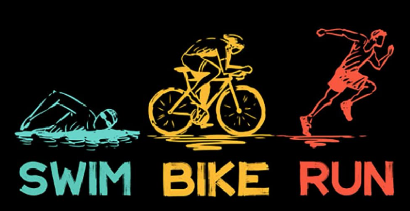

  

<h1 align="center">
  
</h1>

**:man_technologist: Alumni @ 42 Heilbronn.**

**:exploding_head: In my free time I work on my C++ & Vulkan game engine, mastery projects at 42 and train for marathons/triathlons.**

More about me

:camera: **I love photography** [You can check it out here](https://zstenger93.github.io/wanderlustontheroad/)

:world_map: **& to explore this piece of rock floating in nothingness called :earth_americas:**

:compass: **While constantly getting lost on a top of :mountain: :volcano: or in the :desert: and in the :cityscape:**

:coffee: **Drinker who is eating programming memes for breakfast :trollface:**

:computer: **Aiming to build a better future for the next generations**

***:bulb: I want to wake up in the morning and think the future is going to be great***

***Do you*** :interrobang:

<h2 align="center">🛠️⚡Languages and Tools I use⚡🛠️</h2>

  
  <!--  -->

🎮 When I have free(time);

## Life of a programmer in a nutshell:

